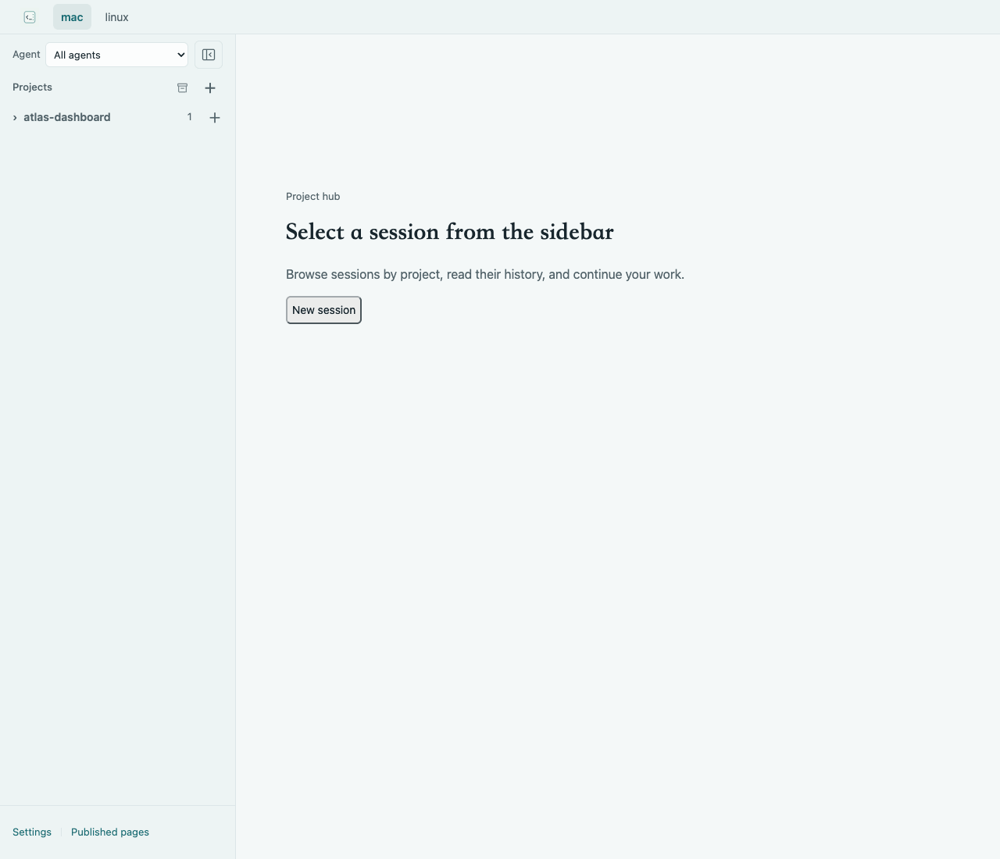
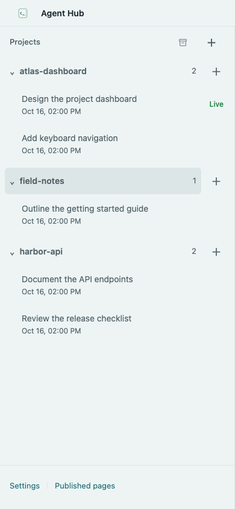
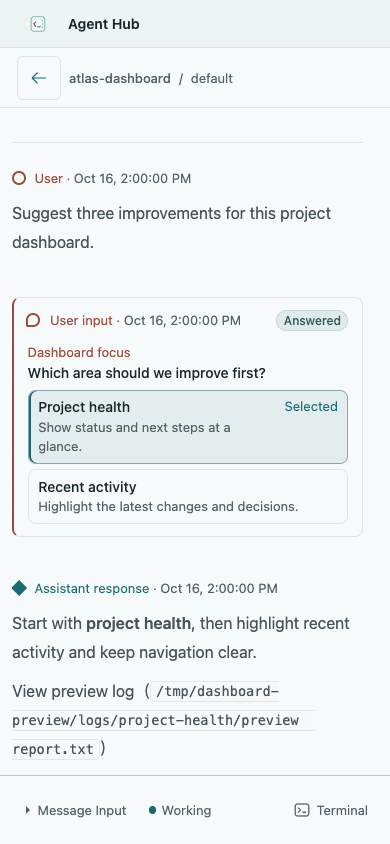
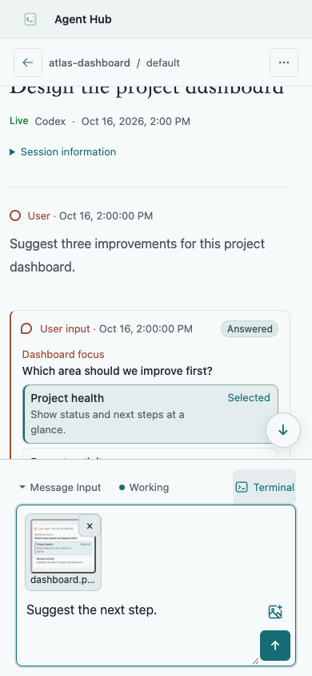
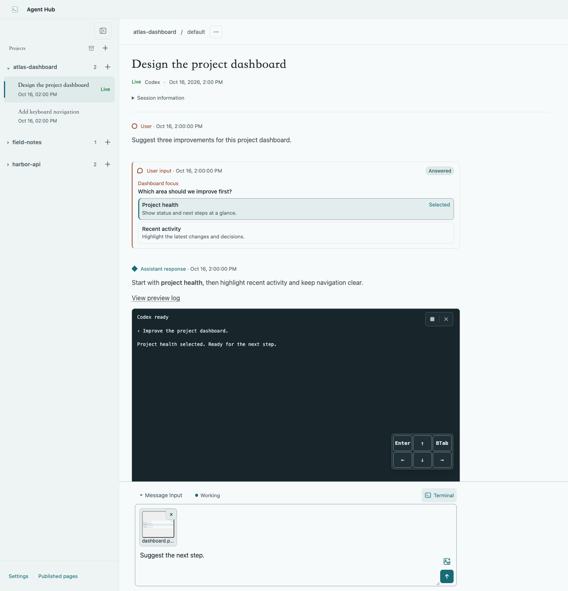

# Agent Hub

English | [简体中文](README.zh-CN.md) | [繁體中文](README.zh-TW.md)

Agent Hub is a web hub for managing Codex and Claude Code sessions on one
machine or across multiple nodes.
Browse sessions by project, follow responses in near real time, and keep
working from desktop or mobile.



<details>
<summary>Mobile screenshots</summary>





</details>

## Quick start

Runtime requirements:

- macOS or Linux with Node.js >=22.13 and npm
- A locally configured Codex or Claude Code CLI
- tmux for creating, resuming, and interacting with sessions

Hub reads `~/.codex` and `~/.claude` by default. You can use either runtime or both;
see [Agent configuration](docs/usage.md#multiple-agents) for custom directories.

Install globally and start Hub:

```sh
npm install -g @someonegg/agent-hub
agent-hub
```

Open <http://127.0.0.1:4173>. Use **Settings → Language** at the bottom of the
sidebar to switch between English (the default), 简体中文, and 繁體中文. The
browser saves your choice. Press `Ctrl-C` to stop the server.
For agent configuration, ports, and optional page/diff hosting, see
[Usage](docs/usage.md).

To upgrade, run `npm install -g @someonegg/agent-hub@latest` again.
For running from source, see [Development](docs/development.md).

## Multi-node mode

Run `agent-hub --node-only` on each machine that runs Codex or Claude Code.
Start the Hub with one `--node id=origin` option per node. Switch nodes using the
tabs at the top of the web interface.

See [multi-node setup](docs/usage.md#use-multiple-nodes) for commands and network
configuration.

## Features

- Navigate projects and sessions.
- Read conversation messages, plans, and user input with Markdown, code, tables, and math.
- Follow conversation updates while browsing their history.
- Create sessions with optional worktrees, send input, and preview their terminals.
- View live sessions, resume exited sessions, stop session execution, and archive or delete history.
- [Publish static pages and review diffs](docs/usage.md#publish-pages-and-diffs) with optional local hosting.
- Switch the interface between English, Simplified Chinese, and Traditional Chinese.

## Session interaction

Send prompts and control the live terminal from the session page. Take photos,
paste images, or drop files, then preview and send.
See [file uploads](docs/usage.md#file-uploads) for storage, cleanup, and file limits.

<details>
<summary>Show session interaction screenshot</summary>



</details>

Expand **Terminal** to follow the CLI and handle prompts with the on-screen
controls. See [session interaction](docs/usage.md#send-prompts-and-files) for keyboard
shortcuts, interruption, and session handoff.

## Command-line management

Use `ahub-cli session` to list, create, resume, inspect, and manage sessions from
another terminal, or send input to a live session. Add `--json` for structured
output in scripts and agent workflows.
See [session CLI usage](docs/usage.md#session-commands) for commands and examples.

For agent-assisted session workflows, use the bundled
[`ahub-control` skill](skills/ahub-control). Run
`ahub-cli skill path ahub-control` to locate it.

## Security

Agent Hub reads session history and controls connected CLI sessions through
tmux on the machine where they run. The configured CLI handles model access,
authentication, and credentials.

The server binds to loopback by default. Interaction and management are enabled
without application authentication. Before exposing it to a network, add
authentication, such as the built-in mTLS option, and restrict access. See the
[security guidance](docs/usage.md#access-from-other-devices).

## Documentation

- [Usage and configuration](docs/usage.md)
- [Technical reference](docs/technical-reference.md)
- [Development and screenshots](docs/development.md)
- [All documentation and architecture decisions](docs/README.md)

Community: [LINUX DO](https://linux.do/)
